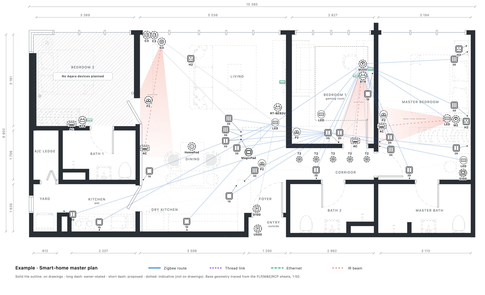

# Smart-home floor plan maker

Turn a home's architect drawing (PDF) into an interactive web page that shows every smart-home device on the real floor plan: switches, hubs, sensors, Wi-Fi, curtain motors, LED strips. You can drag devices around, check signal strength, and send your customer a private link to view it on their phone.

You don't need to know any code. An AI helper called **Claude Code** does the technical work; you talk to it in plain English.



---

## What you need before you start

| You need | Why | Cost |
| --- | --- | --- |
| A laptop: **Mac** (macOS 13 or newer), **Windows** 10/11, or **Linux** (Ubuntu 20.04+ / Debian 10+), with 4 GB+ memory | Claude Code runs on it | Free |
| An internet connection | Claude thinks online | |
| A **Claude Pro or Max** plan ([claude.ai/upgrade](https://claude.ai/upgrade)) | Claude Code needs a paid plan; the free plan doesn't include it | Monthly subscription |
| Your customer's drawing as a **PDF exported from the architect's software** (AutoCAD, ArchiCAD, SketchUp...) | Claude traces the walls from it. A scan or phone photo of paper won't trace | Ask the architect / ID |
| *Optional:* **VS Code** 1.94 or newer ([code.visualstudio.com](https://code.visualstudio.com)) | Only for the click-instead-of-type way below | Free |

**Everything else is installed for you by Claude** in Step 4: uv (runs the tools), Python, git (saves history), and a browser engine (for picture exports). You just click "Yes" when your laptop asks.

### Who does what

| You do | Claude does |
| --- | --- |
| Install Claude Code (Step 2, one copy-paste) | Installs every other tool |
| Log in to your Claude account in the browser | Checks your laptop and fixes what's missing |
| Give it the customer's PDF and tell it which devices the home gets | Traces the walls, places devices, builds the page |
| Look at the page and say what to move | Makes the changes |
| Say "yes" before anything goes online | Publishes it with a password and gives you the link |
| Send the link and password to your customer | Keeps a history of every change |

### Pick how you'll talk to Claude

- **The terminal way** (Steps 1 to 4 below): a plain text window. Fewest things to install.
- **[The VS Code way](#the-vs-code-way-instead-of-steps-1-2-and-4)**: a normal app with a chat panel and buttons. Pick this if a typing-only window feels scary.

Both end up in the same place, and Steps 5 and 6 work the same in both.

---

## Step 1: Open the terminal

The terminal is a window where you type instructions. You'll only need it to start Claude.

- **Mac:** press `Cmd` + `Space`, type `Terminal`, press `Enter`.
- **Windows:** click Start, type `PowerShell`, click **Windows PowerShell**.
- **Linux:** press `Ctrl` + `Alt` + `T`.

A window with a blinking cursor opens. That's it.

## Step 2: Install Claude Code

Copy the line for your laptop, paste it into the terminal (right-click → Paste, or `Cmd`+`V` / `Ctrl`+`V`), and press `Enter`.

**Mac or Linux:**

```bash
curl -fsSL https://claude.ai/install.sh | bash
```

**Windows (PowerShell):**

```powershell
irm https://claude.ai/install.ps1 | iex
```

Wait until it finishes (about a minute). Then **close the terminal and open it again** (Step 1), so it knows about Claude.

Check it worked by typing this and pressing `Enter`:

```bash
claude --version
```

You should see a version number followed by `(Claude Code)`. If it says "not found", close and reopen the terminal once more.

## Step 3: Get this folder onto your laptop

Pick **one** way.

**Way A: Download a ZIP (simplest)**

1. Open this kit's page: [github.com/KennethWKZ/smart-home-floorplan](https://github.com/KennethWKZ/smart-home-floorplan). No account needed.
2. Click the green **Code** button → **Download ZIP**.
3. Unzip it and move the folder into your **Documents** folder. Rename it to `smart-home-floorplan` if it has a different name.

**Way B: Let Claude download it (easier to get updates later)**

1. In the terminal, type `claude` and press `Enter`. The first time, a browser window opens: log in with your Claude account, then come back to the terminal.
2. Type this to Claude and press `Enter`:

   ```text
   Please download https://github.com/KennethWKZ/smart-home-floorplan into my Documents folder with git. Install git first if it's missing.
   ```

3. When it's done, type `/exit` and press `Enter`.

## Step 4: Start Claude inside the folder and let it set everything up

In the terminal, go into the folder and start Claude:

**Mac or Linux:**

```bash
cd ~/Documents/smart-home-floorplan
claude
```

**Windows:**

```powershell
cd $HOME\Documents\smart-home-floorplan
claude
```

If Claude asks "Do you trust the files in this folder?", choose **Yes**.

Now type:

```text
Set up my laptop for this project
```

Claude checks your laptop, installs what's missing, and opens an example plan in your browser. Along the way:

- When Claude asks permission to run something, it tells you what it's for. Press `1` (**Yes**) to allow it.
- If your laptop shows a pop-up ("Install developer tools?", "Allow this app to make changes?"), click **Install** / **Yes**.
- If Claude asks you to type your computer password, type it (nothing shows on screen while you type; that's normal) and press `Enter`.

When it says setup is done, you're ready.

## The VS Code way (instead of Steps 1, 2 and 4)

VS Code is a free app from Microsoft. Its Claude Code add-on gives you a chat panel with buttons, and it brings Claude Code with it, so you skip the terminal install.

1. **Install VS Code** from [code.visualstudio.com](https://code.visualstudio.com) and open it.
2. **Get this folder** with [Step 3, Way A](#step-3-get-this-folder-onto-your-laptop) (the ZIP download).
3. In VS Code, click **File → Open Folder...** and choose the `smart-home-floorplan` folder in your Documents. If VS Code asks **"Do you trust the authors of the files in this folder?"**, click **Yes, I trust the authors**.
4. A message appears in the bottom-right corner: **"Do you want to install the recommended extensions?"** Click **Install**. That adds Claude Code (and a small helper that keeps files tidy). Missed the message? Click the **Extensions** icon on the left (four little squares), type `anthropic.claude-code`, and click **Install**.
5. Click **✻ Claude Code** in the bottom-right corner of the window. A chat panel opens. The first time, click **Sign in** and log in with your Claude account in the browser, then come back to VS Code.
6. In the chat box, type `Set up my laptop for this project` and press `Enter`. Then follow the same tips as in Step 4: allow what Claude asks for, and click **Yes** on laptop pop-ups.

If Claude asks you to run a command yourself (it happens on Linux, for things that need your password), open VS Code's terminal with **Terminal → New Terminal**, paste the command there, and press `Enter`.

From now on, open VS Code (it reopens the folder), click **✻ Claude Code**, and carry on with Step 5.

## Step 5: Make a plan for a customer

Start Claude in the folder (Step 4, first part, or click **✻ Claude Code** in VS Code), then type:

```text
Make a new plan for a customer
```

Claude asks you three things:

1. **The drawing PDF.** Drag the PDF file from your Finder / File Explorer into the terminal window and press `Enter`. That pastes its location. In VS Code: drag the PDF into the file list on the left, then tell Claude its name.
2. **A short name** for this customer, like `tan-condo-b12`.
3. **Which devices** the home gets. Start from the example kit and say what to add or remove.

Claude traces the walls, places the devices, and opens the page in your browser. Look at it and tell Claude what to change in plain words ("move the hub into the TV cabinet", "add a curtain motor in the master bedroom").

**To move devices yourself:** drag them on the page, click the **SVG** download button, then drag the downloaded file into the terminal (or VS Code's file list) and tell Claude "use these positions".

## Step 6: Send it to your customer

Type:

```text
Publish the plan for tan-condo-b12
```

Claude asks you to confirm, then puts the page online with a password and gives you a **link** and a **password**. Send them to your customer in **two separate messages**. They open the link, type the password once, and see their plan (it works on phones).

Changed something later? Say **"publish again"**: the same link updates, same password. Lost the link or password? Ask **"what's the link and password for tan-condo-b12?"**

---

## Things to know

- **Every plan lives in its own folder** inside `plans/`. `plans/example` is a finished example to learn from (a real apartment, anonymised).
- **Keep customer drawings private.** Your plans stay on your laptop. If you ever put your copy of this folder on GitHub, make that repository **private**.
- **Never share the `.publish.json` file** inside a plan folder. It's the key that controls the live page. Claude keeps it out of git automatically.
- **Pages can't be deleted** from the hosting service (ht-ml.app) once online, only changed or locked. That's why everything is password-protected.
- **Claude saves a history** of every change (with git), so you can always say "undo the last change" or "go back to how it was yesterday".

## Licence

The code and guides are free to use, change and share under the [MIT licence](LICENSE).

**The example floor plan is not covered by that licence.** Its walls, doors, furniture and ceiling layout (`plans/example/build/geometry.json` and `rcp.json`, and the drawings they produce in its `index.html` and `exports/`) were traced from a real apartment's architect drawings, with names removed. They're included only to show how the kit works, and the rights stay with whoever owns the original drawings. For real work, use your own customers' drawings.

## When something goes wrong

| What you see | What to do |
| --- | --- |
| `claude: command not found` / `not recognized` | Close the terminal, open it again, try again. Still failing? Redo Step 2. |
| Windows: "running scripts is disabled on this system" | Run this once in PowerShell, then redo Step 2: `Set-ExecutionPolicy -Scope CurrentUser RemoteSigned` (answer `Y`). |
| Claude says your plan isn't included | Claude Code needs a Pro or Max plan. Upgrade at [claude.ai/upgrade](https://claude.ai/upgrade), then type `/login` in Claude. |
| VS Code: no **✻ Claude Code** button | Check the add-on is installed (step 4 of the VS Code way), then click **View → Command Palette**, type `Developer: Reload Window`, and press `Enter`. |
| VS Code: Claude does nothing, and a bar says "Restricted Mode" | Click the bar and choose **Trust**. Claude can't work in a folder you haven't trusted. |
| "This drawing is a picture" | Ask the architect or ID for the PDF exported from their CAD software, not a scan. |
| Anything else | Tell Claude what happened in your own words, or paste the message you saw. It will fix it or tell you exactly what to click. |

---

<sub>For the AI: start with `CLAUDE.md`. The step-by-step guides live in `.claude/skills/` (setup-laptop, new-plan, publish-plan).</sub>
